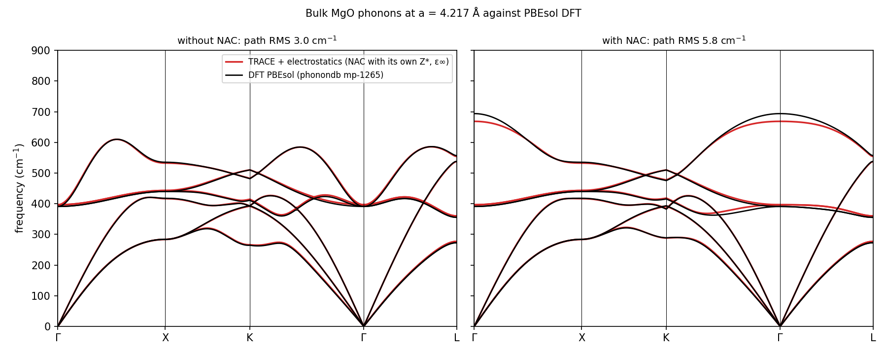

# Bulk MgO phonons with TRACE + electrostatics against PBEsol DFT (results only)

**This folder holds results only.** The model uses TRACE's electrostatics packages (`trace_electrostatics`,
`trace_redox`) and a development version of `train.py`, which are not yet public. The folder contains:
- the figure;
- the model's band structures (`bands/`);
- the run's configuration for reference (`config.yaml`).

The training data, the PBEsol reference and the phonon settings are the same as in the local example,
[`../mgo_phonons_local`](../mgo_phonons_local). The difference is the model. Here TRACE predicts its own Born effective
charges Z* and its own high-frequency dielectric constant ε∞, so the LO–TO splitting comes from the model. The local
model has none and needs DFT's values.

## Model and training

- **Start:** a TRACE + electrostatics model trained for 40 epochs on the 4G-HDNNP Au₂/MgO(001) data set (Ko, Finkler,
  Goedecker and Behler, Nat. Commun. 12, 398 (2021)).
- **Fine-tune:** 40 epochs on the local example's 180 PBEsol MgO cells, on forces only (the energies were masked), with
  seeds 42 and 43.
- **Labels for Z* and ε∞:**
  - No Born-charge labels are used anywhere, so Z* is a prediction.
  - ε∞ carries a weak prior toward the experimental 2.95 (Sun et al., arXiv:0704.2267, Table I), on one 8-atom MgO cell
    at a = 4.265 Å with weight 0.05. The model ends at 3.54 nonetheless.
  - A second prior fixes the polarizability of an isolated Au atom; it does not involve MgO.

## How Z* and ε∞ enter the phonons

At a = 4.21726 Å, on the 64-atom cell:
- **Z\*(Mg)** is the formal charge +2 plus the electrostatic sector's induced-dipole response, −0.0575 e. That gives
  Z\*(Mg) = −Z\*(O) = 1.943 (seed 43). The acoustic sum rule holds to 1.5e-13.
- **ε∞** comes from the same electrostatic sector.
- **Phonons:** these Z* and ε∞ enter the NAC with the phonopy settings of the reference calculation, as in the local
  example.
- **Born–Huang check:** phonopy's √(LO² − TO²) = 538.4 cm⁻¹ equals 4πK_E Z*²/(Ω μ ε∞) = 538.4 cm⁻¹ (seed 43).

## Result



All values are at a = 4.21726 Å against phonondb PBEsol (mp-1265), frequencies in cm⁻¹. Path RMS is taken over
Γ–X–K–Γ–L with the frequencies sorted at each q-point.

| model | Z*(Mg) (DFT 1.979) | ε∞ (DFT 3.242) | TO at Γ (DFT 391.0) | LO at Γ (DFT 693.9) | RMS without NAC | RMS with NAC |
|---|---|---|---|---|---|---|
| TRACE + electrostatics, seed 43 (figure) | 1.943 | 3.541 | 396.7 | 668.7 | 3.0 | 5.8 (its own Z*, ε∞) |
| TRACE + electrostatics, seed 42 | 1.942 | 3.541 | 392.9 | 666.3 | 2.2 | 5.9 (its own Z*, ε∞) |
| TRACE local, seed 43 ([`../mgo_phonons_local`](../mgo_phonons_local)) | none | none | 391.2 | = TO | 1.7 | 54.0 (no Z*); 1.7 with DFT's Z*, ε∞ |

To recompute the RMS, run this from the repository root:

```bash
python examples/mgo_phonons_local/score_bands.py examples/mgo_phonons_electrostatics/bands/seed43
```

## Reading

- **Force constants:** without NAC both models reproduce PBEsol to within 1.7–3.0 cm⁻¹ RMS. The 64-atom cells'
  force constants are learnable with or without electrostatics.
- **LO–TO splitting:**
  - The electrostatic model gives the splitting from its own Z* and ε∞, with a NAC path RMS of 5.8–5.9 cm⁻¹.
  - The local model has no LO–TO splitting (RMS 54.0). It reaches 1.7 only when DFT's Z* and ε∞ are supplied from
    outside.
- **Where the electrostatic model falls short:**
  - LO is 3.6–4.0 % low (666.3–668.7 against 693.9).
  - Z* is within 1.9 % of DFT, but ε∞ is 9 % too high (3.54 against 3.24). So Z*²/ε∞, which sets LO² − TO², is 12 %
    low.
  - Against the windows we fixed before the runs, this model fails two: ε∞ (2.9–3.5) and LO (673–713 cm⁻¹).
- **Scope:** bulk MgO at one lattice constant. The fine-tune used bulk cells only, so nothing here concerns surfaces or
  the 4G Au₂/MgO tests.
