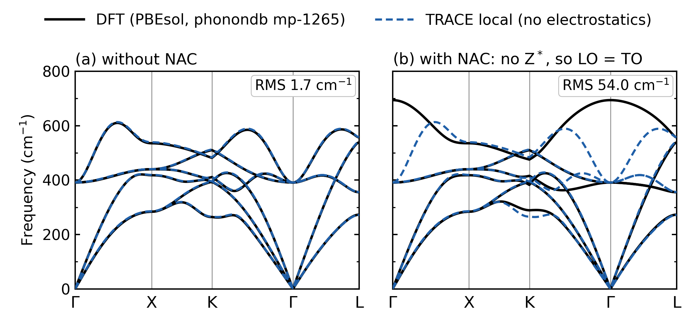

# Bulk MgO phonons with TRACE (local model, no electrostatics) against PBEsol DFT

TRACE's local backbone, trained on 180 DFT supercells of rocksalt MgO, compared with the PBEsol phonon band structure
of phonondb (mp-1265) along Γ–X–K–Γ–L.

## Data

A. Togo's PBEsol training set for MgO, NIMS Materials Data Repository (CC BY 4.0): 200 rocksalt 2×2×2 supercells of
64 atoms at a = 4.21726 Å, every atom displaced 0.03 Å in a random direction, with VASP forces and supercell energies.
180 cells train and 20 validate (numpy seed 0). The data are not in the repository; `data/README.md` gives the download
link and the extraction command.

The reference bands in `reference/` were computed with phonopy 2.17.2 from phonondb mp-1265 (PBEsol, a = 4.21726 Å). They
are given with and without the non-analytic correction (NAC); the NAC uses DFT's Z*(Mg) = 1.979 and ε∞ = 3.242
(`reference/MgO_PBEsol_phonondb_born.json`). At Γ, DFT gives TO 391.0 cm⁻¹ and LO 693.9 cm⁻¹.

## Run (from the repository root)

```bash
pip install phonopy
python examples/mgo_phonons_local/extract_ltc_pbesol.py phonopy_training_dataset.yaml examples/mgo_phonons_local/data/MgO_PBEsol_ltc
python train.py --config examples/mgo_phonons_local/config.yaml
python examples/mgo_phonons_local/phonons_model.py examples/mgo_phonons_local/run --a 4.21726 --out examples/mgo_phonons_local/run/bands_own
python examples/mgo_phonons_local/phonons_model.py examples/mgo_phonons_local/run --a 4.21726 --out examples/mgo_phonons_local/run/bands_dft_born --born-from examples/mgo_phonons_local/reference/MgO_PBEsol_phonondb_born.json
python examples/mgo_phonons_local/score_bands.py examples/mgo_phonons_local/run/bands_own
python examples/mgo_phonons_local/score_bands.py examples/mgo_phonons_local/run/bands_dft_born
python examples/mgo_phonons_local/plot_bands.py examples/mgo_phonons_local/run/bands_own "TRACE local (no electrostatics)" examples/mgo_phonons_local/run/mgo_phonons_trace_local_vs_pbesol.png --color "#1F5FA8" --nac-note 'no $Z^*$, so LO = TO'
python examples/mgo_phonons_local/plot_bands.py examples/mgo_phonons_local/run/bands_dft_born "TRACE local + DFT's Z*, eps" examples/mgo_phonons_local/run/mgo_phonons_trace_local_dft_born.png --color "#1F5FA8" --nac-note 'DFT'"'"'s $Z^*$, $\epsilon_\infty$'
```

- **Training:** `config.yaml` trains on forces only (`energy_weight: 0`) for 40 epochs of a 100-epoch cosine schedule,
  with r_max 5.29 Å, batch 1, the Muon optimizer at lr 1e-3, and seed 43. It runs on the CPU in float32 with 4 threads and takes about 36 minutes on an Apple M2 Pro.
- **Phonons:** `phonons_model.py` uses the reference calculation's phonopy settings:
  - the conventional cell at a = 4.21726 Å;
  - force constants from 0.01 Å displacements in the 2×2×2 conventional supercell (64 atoms), symmetrised;
  - 51 q-points per path segment;
  - the Γ limit taken at |q| = 1e-3.
- **Scoring:** `score_bands.py` reports the path RMS against DFT, with frequencies sorted at each q-point, and the
  optical frequencies at Γ.

## Result



Vector version: [`mgo_phonons_trace_local_vs_pbesol.pdf`](mgo_phonons_trace_local_vs_pbesol.pdf).

Panel (b) is the model's own band with NAC. The model has no Born charges, so it has no LO–TO splitting: LO = TO =
391.2 cm⁻¹ at Γ, against DFT's 693.9.

All values are in cm⁻¹ at a = 4.21726 Å against phonondb PBEsol. Path RMS is taken over Γ–X–K–Γ–L with the frequencies
sorted at each q-point.

| model | TO at Γ (DFT 391.0) | LO at Γ (DFT 693.9) | RMS without NAC | RMS with NAC | DFT's Z*, ε∞ supplied: LO / RMS with NAC |
|---|---|---|---|---|---|
| seed 43, epoch 40 (figure) | 391.2 | = TO | 1.7 | 54.0 | 694.0 / 1.7 |
| seed 42, epoch 39 | 392.8 | = TO | 2.7 | 53.7 | 694.9 / 2.7 |

- **LO and RMS with NAC** are the model's own. It has no Born charges, so LO = TO and its NAC band is its no-NAC band.
  That band is compared with DFT's band including the NAC (panel b).
- **The last column** applies DFT's Z* and ε∞ to the model's force constants. Its LO–TO splitting comes from DFT and is
  not a prediction of the model. It shows only that the short-range force constants are right. It is not in the figure.

**How these numbers were made.** The two runs used a development version of `train.py` with this config's settings:
forces only and 40 epochs of a 100-epoch cosine schedule, with 2 CPU threads (this config sets 4). For seed 42 the table uses the best
checkpoint, which was at epoch 39. Two things differ from this repository's `train.py`:

- **Energies:** the development version masked the energies of the training cells. Here they are present but weighted 0,
  so the loss is the same.
- **Batch order:** it was drawn from a seeded generator that this `train.py` does not have.

Running `config.yaml` here therefore repeats the same training with a different batch order. **The rerun agrees with the
table to 0.2 cm⁻¹.** We ran `config.yaml` with this repository's `train.py` on 2026-11-09, with 4 threads on an Apple M2 Pro; it
took 36 minutes and its best checkpoint was at epoch 38:
- TO 391.4 cm⁻¹, and LO 694.2 cm⁻¹ with DFT's Z* and ε∞;
- path RMS 1.7 cm⁻¹ without NAC, 53.9 with no Born charges, and 1.7 with DFT's Z* and ε∞.

## What this does and does not show

- **The local model is enough for the force constants.**
  - The 64-atom supercell's force constants reach at most about 4.2 Å, the minimum-image distance. That is inside
    r_max = 5.29 Å.
  - So a local model can represent them, including the supercell's own share of the Coulomb interaction.
- **It cannot predict LO–TO splitting.**
  - A local model has no Born effective charges, so LO = TO at Γ.
  - The LO branch near Γ comes from the long-range dipole field. That needs Z* and ε∞, which here are taken from DFT
    (DFPT) through `--born-from`.
  - With them supplied (the table's last column), the NAC band is as accurate as the no-NAC band, because the NAC is
    analytic once Z* and ε∞ are known.
- **With electrostatics:** [`../mgo_phonons_electrostatics`](../mgo_phonons_electrostatics) shows, as results only,
  TRACE with electrostatics on the same data. It predicts its own Z* and ε∞, with a NAC path RMS of 5.8–5.9 cm⁻¹.
- **One material, one functional, one lattice constant.** This example does not test transferability to surfaces,
  defects, other volumes or charged systems.

Tested with Python 3.8.16, torch 2.2.0, e3nn 0.4.4, ase 3.23.0, numpy 1.24.2 and phonopy 2.17.2, on an Apple M2 Pro CPU.
